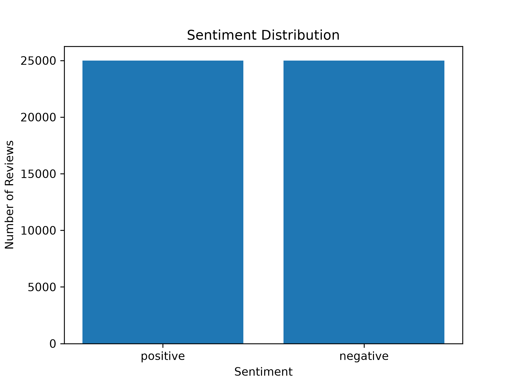
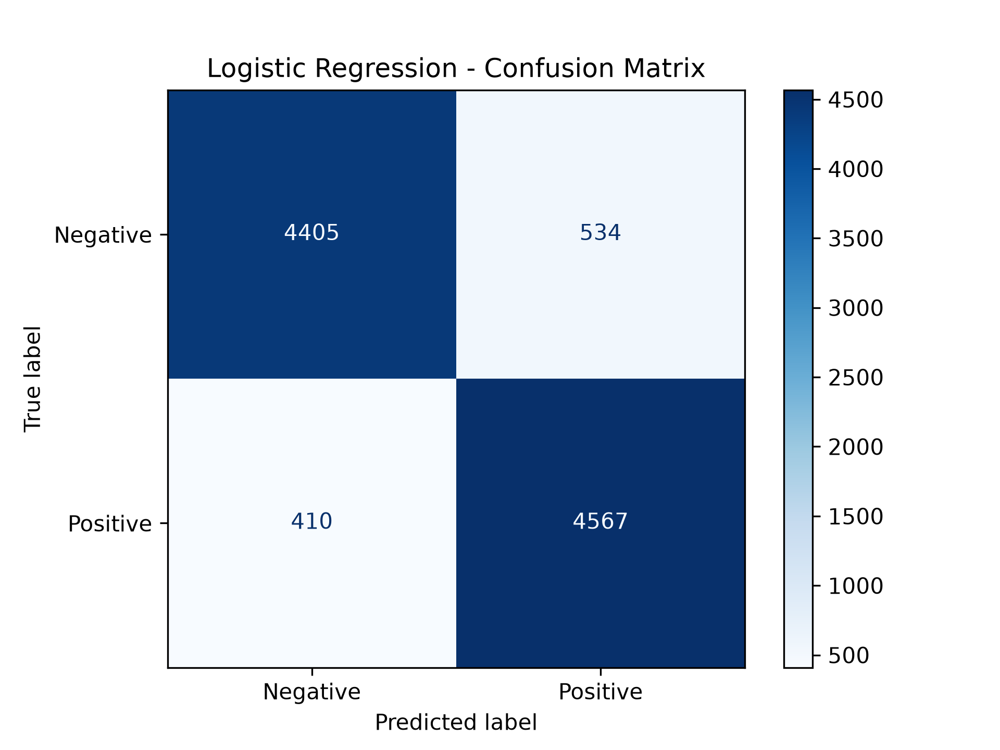
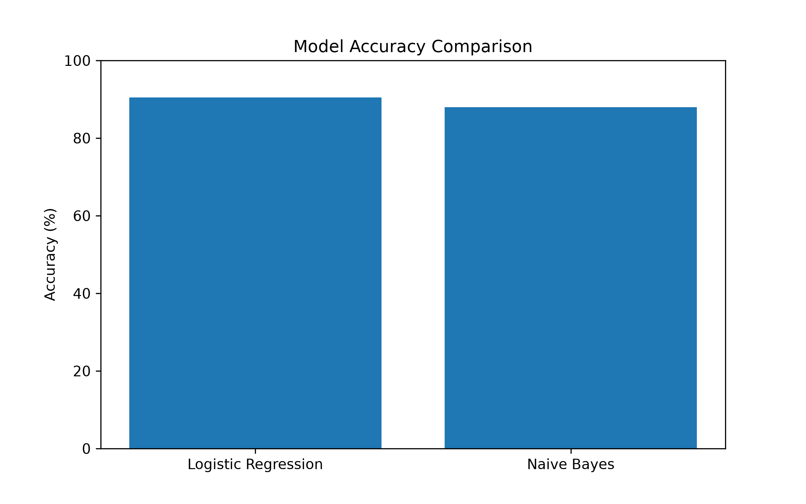

# 🎬 IMDb Sentiment Analysis

*Turning movie reviews into meaningful insights.*

🌷 A Machine Learning & Natural Language Processing Project 🌷

---

## 🌸 About the Project

Have you ever wondered whether a movie review expresses
a positive or negative sentiment?

This project uses Machine Learning and Natural Language
Processing to classify English movie reviews using
TF-IDF and Logistic Regression.

The trained model is integrated into an interactive
Streamlit web application.

## 🎀 Live Demo

Explore the application directly in your browser.
No installation required!

👉 [Try IMDb Sentiment Analysis](https://imdb-sentiment-analysis-hewzdukyjantybrp2ch36v.streamlit.app/)

## 📊 Project at a Glance

| Metric | Value |
| :--- | ---: |
| Original Dataset | 50,000 |
| Cleaned Dataset | 49,576 |
| Training Samples | 39,660 |
| Testing Samples | 9,916 |
| TF-IDF Features | 20,000 |
| Test Accuracy | **90.69%** |

## 🛠️ Tech Stack

- Python 3.12
- Pandas & NumPy
- Matplotlib
- Scikit-learn
- Streamlit
- Joblib
- Natural Language Processing

## 🧠 Machine Learning Workflow

1. Data collection
2. Exploratory data analysis
3. Text preprocessing
4. Duplicate removal
5. Train-test split
6. TF-IDF feature extraction
7. Model training and comparison
8. Hyperparameter optimization
9. Model evaluation
10. Model serialization
11. Web application development

## 🧹 Text Preprocessing

The preprocessing pipeline includes:

- Lowercase conversion
- HTML tag removal
- URL removal
- Number removal
- Punctuation removal
- Whitespace normalization

## 💡 Model Selection

Two machine learning algorithms were evaluated:

- Logistic Regression
- Multinomial Naive Bayes

Logistic Regression was selected as the final model
due to its better classification performance.

GridSearchCV was used for hyperparameter optimization.

## 📈 Results & Visualizations

The optimized Logistic Regression model achieved
a test accuracy of **90.69%**.

### 🌷 Sentiment Distribution

### 🌷 Confusion Matrix

### 🌷 Model Comparison

## ✨ Application Features

- English movie review analysis
- Positive and negative sentiment classification
- Sentiment probability scores
- Interactive Streamlit interface
- Review-based movie recommendations

## 💻 Getting Started

Install the required dependencies:

    pip install -r requirements.txt

Run the Streamlit application:

    python -m streamlit run app.py

For command-line predictions:

    python predict.py

## 📚 Dataset

This project uses the
[IMDb Dataset of 50K Movie Reviews](https://www.kaggle.com/datasets/lakshmi25npathi/imdb-dataset-of-50k-movie-reviews).

The dataset is not included in this repository.

To reproduce the training process, download the dataset
and place it inside the `data` folder.

Then run:

    python preprocessing.py
    python optimization.py

## 📝 Limitations

The model is trained on English movie reviews.
Sarcasm, ambiguous expressions and reviews from other
domains may reduce prediction performance.

## 🌱 Future Improvements

- [ ] Neutral sentiment classification
- [ ] Multilingual sentiment analysis
- [ ] Deep learning models
- [ ] Rating prediction

## 💌 Conclusion

This project demonstrates an end-to-end machine learning
workflow, from raw text data to an interactive web
application.

---

Made with Python, curiosity & a little bit of love. ♡

⭐ If you like this project, feel free to give it a star!

